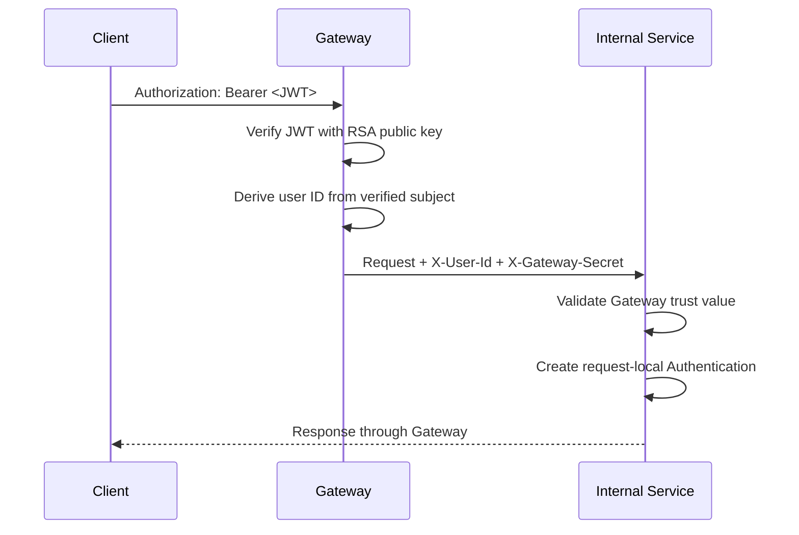

<div align="center">

# 🚪 ChessTracker API Gateway

### One entry point. Verified tokens. Trusted identity propagation.

[](https://openjdk.org/)
[](https://spring.io/projects/spring-boot)
[](https://spring.io/projects/spring-cloud-gateway)
[](https://spring.io/projects/spring-security)

[← ChessTracker](https://github.com/illia-krupko/chess-tracker) · [User Service](https://github.com/illia-krupko/chess-tracker-user-service) · [Infrastructure](https://github.com/illia-krupko/chess-tracker-infrastructure)

</div>

---

## 🚪 Responsibility

The Gateway is the public HTTP entry point for ChessTracker. It centralizes request routing and access-token validation, then forwards requests to the appropriate internal Spring Boot service.

This project uses **Spring Cloud Gateway Server MVC** rather than the reactive WebFlux gateway. Route configuration lives in `src/main/resources/application.yaml`.

## 🧭 Configured routes

| Public path | Destination | Path transformation | Identity filter |
|---|---|---|---|
| `/auth/**` | User Service (`USER_SERVICE_URI`) | Prefix `/api` | No `SetUserId`; supports login and registration |
| `/users/**` | User Service (`USER_SERVICE_URI`) | Prefix `/api` | `SetUserId` |
| `/games/**` | Game Service (`GAME_SERVICE_URI`) | Prefix `/api` | `SetUserId` |
| `/analysis/**` | Analysis Service (`ANALYSIS_SERVICE_URI`) | Prefix `/api` | `SetUserId` |
| `/statistics/**` | Statistics Service (`STATISTICS_SERVICE_URI`) | Prefix `/api` | `SetUserId` |

The default destination ports are `8082` for games, `8083` for users, `8084` for analysis, and `8085` for statistics. Override the corresponding URI settings if your services use different host ports or Docker network addresses.

## 🔐 Authentication and trust boundaries



### RSA verification

The Gateway uses `spring.security.oauth2.resourceserver.jwt.public-key-location: classpath:keys/public.pem`. User Service signs tokens with the private key; the Gateway uses the matching public key to verify them.

### Identity propagation

Protected routes apply the custom `SetUserId` filter to derive `X-User-Id` from the validated token. The Gateway also sends `X-Gateway-Secret`, which downstream services validate as part of the trusted internal request path.

**Security rule:** never trust a client-supplied identity header. Internal services must not be directly exposed to untrusted traffic, and resource ownership checks still belong in the relevant domain service.

## 🛠️ Technology stack

- Java 21 · Spring Boot 4.1.1
- Spring Cloud release train `2025.1.3`
- Spring Cloud Gateway Server MVC
- Spring Security OAuth2 Resource Server / JWT
- RSA public-key verification
- Spring Boot Actuator
- Gradle, Lombok, Checkstyle, JUnit / Spring Boot test support

## ⚙️ Configuration

The Gateway imports an optional local `.env` file as properties. Important settings:

| Variable / setting | Purpose |
|---|---|
| `GAME_SERVICE_URI` | Game Service; default `http://localhost:8082` |
| `USER_SERVICE_URI` | User Service; default `http://localhost:8083` |
| `ANALYSIS_SERVICE_URI` | Analysis Service; default `http://localhost:8084` |
| `STATISTICS_SERVICE_URI` | Statistics Service; default `http://localhost:8085` |
| `SHARED_GATEWAY_SECRET` | Internal trust value inserted into requests |
| `keys/public.pem` | RSA public key for access JWT verification |

Spring Boot listens on port `8080` by default. The public key must correspond to User Service's private signing key. The Gateway does not need the private key. Do not commit secrets.

## 🚀 Run locally

### Prerequisites

- JDK 21
- Reachable ChessTracker services
- Matching RSA public key at `src/main/resources/keys/public.pem`
- `SHARED_GATEWAY_SECRET` configured consistently across the Gateway and downstream services

From this repository root:

```bash
./gradlew clean build
./gradlew bootRun
```

When the Gateway runs on the host and services run in Docker, use published host ports. When all applications share a Docker network, use service DNS names and internal ports. Inside a container, `localhost` refers to that container itself.

## 🧰 Troubleshooting

| Symptom | First checks |
|---|---|
| `401 Unauthorized` | Missing/expired/malformed JWT or wrong public key |
| `403 Forbidden` | Authorization rules in the Gateway or downstream service |
| `502` / connection error | Destination URI, port, service health, Docker network membership |
| User ID missing downstream | JWT subject and `SetUserId` filter on the route |
| Gateway trust rejected | `SHARED_GATEWAY_SECRET` mismatch or downstream trust-filter configuration |
| Host works but Docker fails | Host port versus internal port; `localhost` versus service DNS |

## 🔗 Related repositories

[ChessTracker](https://github.com/illia-krupko/chess-tracker) · [User Service](https://github.com/illia-krupko/chess-tracker-user-service) · [Game Service](https://github.com/illia-krupko/chess-tracker-game-service) · [Analysis Service](https://github.com/illia-krupko/chess-tracker-analysis-service) · [Statistics Service](https://github.com/illia-krupko/chess-tracker-statistics-service) · [Infrastructure](https://github.com/illia-krupko/chess-tracker-infrastructure)
